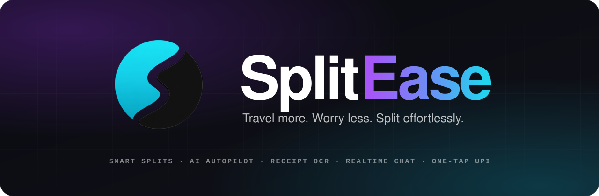
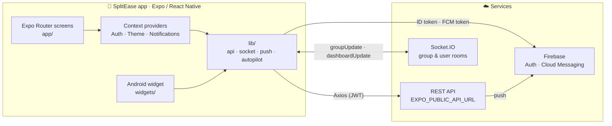
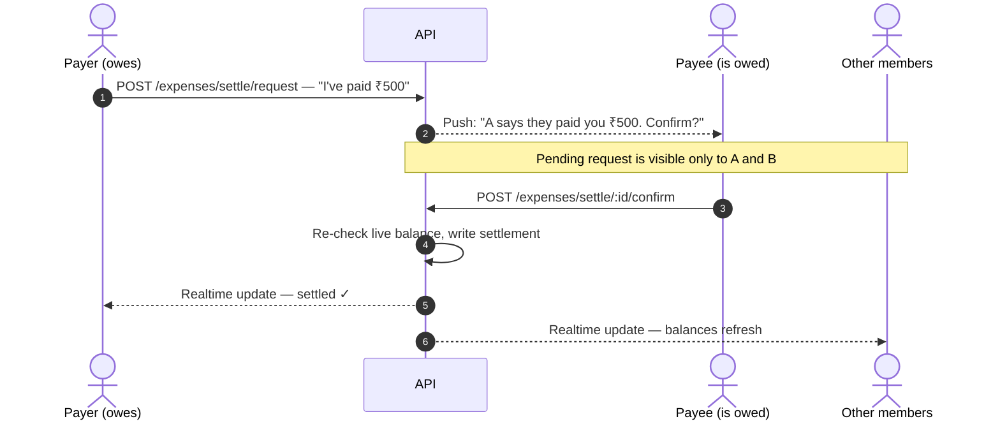

<div align="center">

<a href="https://play.google.com/store/apps/details?id=com.kunal.splitapp">
  
</a>

<br />
<br />

**A premium group expense manager for trips, flatmates and everyday hangouts.**<br />
Exact splits · an AI agent that does the admin · receipt scanning · realtime chat · one-tap UPI settle.

<br />

<a href="https://play.google.com/store/apps/details?id=com.kunal.splitapp"></a>

<br />

[](#)
[](https://expo.dev)
[](https://reactnative.dev)
[](https://react.dev)
[](https://firebase.google.com)

[](LICENSE)
[](CONTRIBUTING.md)
[](https://github.com/Gautam5514/splitApp/labels/good%20first%20issue)
[](https://github.com/Gautam5514/splitApp/stargazers)

<br />

[**Features**](#-features) &nbsp;·&nbsp;
[**Autopilot**](#-autopilot) &nbsp;·&nbsp;
[**Rewards**](#-rewards--elite-club) &nbsp;·&nbsp;
[**Architecture**](#-architecture) &nbsp;·&nbsp;
[**Design**](#-design-language) &nbsp;·&nbsp;
[**Quick start**](#-quick-start) &nbsp;·&nbsp;
[**Troubleshooting**](#-troubleshooting) &nbsp;·&nbsp;
[**Contributing**](#-contributing)

</div>

<br />

<div align="center">
  
  
  
  
  
  <p><sub>Live screenshots from the <a href="https://play.google.com/store/apps/details?id=com.kunal.splitapp">Google Play listing</a></sub></p>
</div>

---

## ✦ Why SplitEase

Splitting bills with friends usually means a messy spreadsheet, a dozen "who owes what" texts, and someone always forgetting to pay up. **SplitEase** replaces all of that with one clean flow:

> **Create a group → log the expense (or just scan the receipt) → let the app net the balances and settle them in the fewest possible payments.**

Trusted by **10,000+ travelers** and live on Google Play as **Splitease**.

<table>
  <tr>
    <td align="center" width="25%"><h3>🧮</h3><b>4 split modes</b><br /><sub>equal · % · shares · exact</sub></td>
    <td align="center" width="25%"><h3>🧭</h3><b>AI Autopilot</b><br /><sub>Hinglish, approval-gated</sub></td>
    <td align="center" width="25%"><h3>⚡</h3><b>Min-transfer settle</b><br /><sub>fewest payments, one-tap UPI</sub></td>
    <td align="center" width="25%"><h3>💬</h3><b>Realtime</b><br /><sub>chat + ledger over Socket.IO</sub></td>
  </tr>
</table>

---

## ✦ Features

| | Feature | What it does |
|:-:|---|---|
| 🧭 | **Autopilot** | Type *"rent 20000"* or *"dinner 3000 Rahul ko chhod ke"*. Autopilot drafts a plan you review and approve, then does the work. |
| 🧮 | **Smart Split Engine** | Split equally, by percentage, by shares or by exact amount. The math is handled the moment an expense is added. |
| 📸 | **AI Receipt Scanner** | Snap any bill. OCR reads every line item, itemizes it and drops it straight into the group. |
| 💬 | **Settle Chat** | Group chat and the expense ledger live in the same thread. Every bill and payment is part of the conversation, in real time. |
| ⚡ | **Minimum-Transfer Optimizer** | Nets every balance in the group and routes the fewest possible payments to settle everyone up. |
| 💳 | **One-Tap UPI Settle** | Pay straight from the app via UPI ID or QR. The payee confirms, and balances reset automatically. |
| 🤝 | **Two-Party Confirmation** | A settlement is only confirmed by the person on the other side of it. Nobody else in the group is asked. |
| 🗂️ | **Groups at a glance** | Every group is one card that says where you stand — *You owe ₹560*, *You get back ₹1,240* or *All settled up*. Active and Completed sit in two tabs. |
| 🧾 | **A group page that answers first** | Your balance on top, one Add Expense button, who pays whom, then the expenses newest-first and everyone's balance. |
| 🔔 | **Push Notifications** | Alerts for new expenses, chat, settlements and invites, plus a few well-timed tips. |
| 📱 | **Home Screen Widget** | An Android widget shows live balances — what you owe and what's owed to you. |
| 🎨 | **Themes** | White and Black modes, plus four accent themes you unlock with referral coins or your Elite tier. |
| 🏅 | **Referral rewards** | Invite friends, earn coins, climb tiers. Your tier shows as a badge next to your name in every group. |
| 🔐 | **Secure Auth** | Email/password and Google Sign-In, backed by Firebase Auth and Expo Secure Store. |
| 🔗 | **Instant Invites** | Every group has a link, a 6-character code and a QR code. Friends join by tapping the link, typing the code, or scanning the QR with the camera or from a screenshot. |
| 🤖 | **AI Chat Assistant** | Ask questions about a group's spending and get conversational answers. |
| 📊 | **Breakdowns & Charts** | Who spent what, and where the group's money actually went. |

---

## ✦ Autopilot

An approval-gated AI agent, built into the app as a full screen (not a floating bubble). Tap the glossy blue **3D Autopilot icon** in the header of Home, Groups or any group. Inside a group it opens already working in that group.

| You say | Autopilot does |
|---|---|
| `rent 21000` | Plans Rent ₹21,000, paid by you, split with the group's usual split |
| `make it 24000` · `Ravi ko hata do` · `Priya bhi` | Updates the waiting plan instantly |
| `pizza 600 with Aman and Priya` | Splits between just the three of you |
| `Create group Goa Trip with Aman, budget 40000` | New trip group, invites, budget |
| `who owes whom?` · `my total balance` · `show food expenses` | Answers right away, changes nothing |
| `delete last expense` | Shows a red "can't be undone" card; only the red button deletes |

> [!IMPORTANT]
> **You stay in control.** Nothing changes until you approve. The button shows the amount (*"Approve ₹1,200"*). Typing *"haan"* or *"yes"* approves small plans; deletes and amounts over ₹50,000 always need the button.

- **Edit, don't retype** — *"Edit amount or people"* opens a sheet to change title, amount and who shares it.
- **Remembers the conversation** — leave and come back; the chat and any waiting plan are still there.
- **Same brain as the web** — it uses the shared `/agent` API, so web and app always behave the same.

**Smart tips.** A tip on the 1st of the month, one weekend nudge and a few trip ideas in November–December arrive as normal notifications (bell + push), at most one a day and never at night. Tapping one opens Autopilot with a ready draft, such as *"Create group Puri Trip, budget 30000"*.

---

## ✦ Rewards — Elite Club

Invite a friend with your code or link. The moment they join, **you get 50 coins and they get 25**. Coins do two things: they raise your tier, and you can spend them on themes.

| Tier | Coins earned | What you get today |
|---|:-:|---|
| 🥉 Bronze | 100 | Bronze badge · **one accent theme free** (your pick) |
| 🥈 Silver | 300 | Silver badge · **every accent theme free** |
| 🥇 Gold | 750 | Gold badge · every accent theme |
| 💎 **Elite Club** | 1,500 | Elite badge · every accent theme |

- **The badge** sits next to your name on your profile and in each group's member list, so friends see it.
- **Accent themes** recolour the app's ink — buttons, tabs, highlights — on top of White or Black mode: Royal Amethyst (450 coins), Emerald Noir (550), Crimson Velvet (600) and Aurum Gold (700). Pick one in **Profile → Appearance**.
- **Tiers never drop.** They are counted from coins *earned*, not your current balance, so spending coins on a theme can't cost you a badge.
- **The rules live on the server.** Prices, tier thresholds and what each tier unlocks come from the API, so the app and the web always agree.

> [!NOTE]
> Priority support and early access for Gold and Elite are planned, not live yet.

---

## ✦ Architecture



### Settlement flow

Money only moves when **both people involved** agree. Everyone else in the group just sees the balances update.



> [!NOTE]
> If the **payee** records *"I received it"*, the settlement is written immediately, since it can only ever benefit the payer.

---

## ✦ Tech stack

| Layer | Technology |
|---|---|
| **Framework** | [Expo](https://expo.dev) 54 · [React Native](https://reactnative.dev) 0.81 · [React](https://react.dev) 19 |
| **Navigation** | [Expo Router](https://docs.expo.dev/router/introduction/) 6 — typed, file-based routes |
| **Auth** | Firebase Auth · Google Sign-In · Expo Secure Store |
| **Realtime** | Socket.IO client — live chat & balance updates |
| **Networking** | Axios |
| **UI & motion** | Reanimated 4 · Expo Linear Gradient · Expo Blur · Lucide icons · Bricolage Grotesque & Plus Jakarta Sans |
| **Charts** | react-native-svg |
| **Native extras** | Android home-screen widget (`react-native-android-widget`) · Expo Camera (QR invites) · Play Install Referrer · Expo Notifications |
| **Testing** | Jest (`jest-expo`) · React Native Testing Library |
| **Tooling** | TypeScript · ESLint (`eslint-config-expo`) · EAS Build & Submit |

---

## ✦ Project structure

```text
splitApp/
├── app/                      # Expo Router screens (file-based routing)
│   ├── (tabs)/               #   Home · Groups (trips.jsx) · Chat · Profile
│   ├── auth/                 #   Login & registration
│   ├── groups/[id].jsx       #   Group detail — your balance, expenses, settle up
│   ├── chat/ · group-chat/   #   1:1 and group chat threads
│   ├── join/                 #   Join a group: deep link, typed code, QR scan
│   ├── info/                 #   Help center, how it works, pricing, privacy, terms
│   ├── appearance.jsx        #   White / Black mode and accent themes
│   ├── rewards.jsx           #   Refer & earn — coins, code, tiers
│   └── autopilot.jsx · ai-chat.jsx · settings.jsx · profile-edit.jsx …
├── components/               # Reusable UI — modals, charts, chat
│   ├── ui/                   #   Design-system primitives (Design.jsx), sheets, badges
│   ├── icons/                #   Hand-drawn SVG icons (coin, Autopilot, AI)
│   ├── autopilot/            #   Plan cards, approval, edit & group sheets
│   └── __tests__/            #   Component tests
├── context/                  # Auth · Notification · Theme providers
├── lib/                      # API client, Firebase, sockets, push, Autopilot rules, accent themes
├── hooks/                    # Shared React hooks
├── widgets/                  # Android home-screen balance widget
├── constants/                # Design tokens, typography, theme
├── docs/readme/              # README assets
├── android/ · ios/           # Native projects
└── assets/ · public/         # Icons, images, splash, sounds
```

---

## ✦ Design language

One look across every screen, so new screens feel like they were always there.

- **Monochrome ink on a soft canvas.** Black on near-white, or white on true black. Colour is saved for meaning: red when you owe, green when you get money back, gold for coins.
- **Lined headings, not cards.** A section is a title followed by a hairline; its rows sit straight on the canvas. Cards are kept for things that are objects in their own right — a group, the coin wallet.
- **One primary action per screen.** Everything rare goes behind the `⋯` menu, with a line of plain text saying what it does.
- **Tokens and primitives, not one-off styles.** Sizes, radii and the type scale are in [`constants/design.js`](constants/design.js); `ScreenHeader`, `SectionLabel`, `ListRow`, `IconCircle`, `PillButton` and friends are in [`components/ui/Design.jsx`](components/ui/Design.jsx). Read colours from `useDesign()` so accent themes and dark mode work without extra code.

---

## ✦ Quick start

### Prerequisites

- **Node.js 20+** and npm
- [Expo CLI](https://docs.expo.dev/get-started/installation/) via `npx expo`
- A **Firebase** project (Auth + Cloud Messaging) and **Google OAuth** client IDs
- **Xcode** (iOS) and/or **Android Studio** (Android) for native builds

### 1 · Clone & install

```bash
git clone https://github.com/Gautam5514/splitApp.git
cd splitApp
npm install
```

### 2 · Configure

```bash
cp .env.example .env
cp google-services.json.example google-services.json          # Android
cp GoogleService-Info.plist.example GoogleService-Info.plist   # iOS
```

| Variable | Purpose |
|---|---|
| `EXPO_PUBLIC_API_URL` | Backend API base URL. Use your LAN IP (or `10.0.2.2` on the Android emulator), not `localhost`. |
| `EXPO_PUBLIC_FIREBASE_*` | Firebase web-app config — API key, auth domain, project ID, storage bucket, sender ID, app ID |
| `EXPO_PUBLIC_GOOGLE_ANDROID_CLIENT_ID` | Android OAuth client (must match package name + debug SHA-1) |
| `EXPO_PUBLIC_GOOGLE_IOS_CLIENT_ID` | iOS OAuth client |
| `EXPO_PUBLIC_GOOGLE_WEB_CLIENT_ID` | Web OAuth client — required for Firebase-compatible ID tokens |
| `EXPO_PUBLIC_GOOGLE_EXPO_CLIENT_ID` | Expo Go OAuth client |

> [!WARNING]
> `.env`, `google-services.json` and `GoogleService-Info.plist` are git-ignored. **Never commit them.**

> [!NOTE]
> The REST + Socket.IO backend is a separate project and is not in this repository. UI-only contributions (styling, components, layout, docs) don't need one running.

### 3 · Run

```bash
npm run android     # build & install the dev client on an Android emulator / device
npm run ios         # build & install the dev client on an iOS simulator / device
npx expo start      # afterwards: just start the dev server and open the installed app
npm run web         # browser
```

The app uses native modules (camera, push, Google Sign-In, the Android widget), so it runs in a **dev client**, not Expo Go. Build once with `npm run android` / `npm run ios`; after that `npx expo start` is enough until a native dependency changes.

---

## ✦ Scripts

| Command | Description |
|---|---|
| `npm start` | Start the Expo dev server |
| `npm run android` | Build & run the Android dev client |
| `npm run ios` | Build & run the iOS dev client |
| `npm run web` | Run the web build |
| `npm run lint` | Lint with `expo lint` |
| `npm test` | Run the Jest suite |
| `npm run build:apk` | Production APK via EAS |
| `npm run build:production` | Production build for iOS & Android via EAS |
| `npm run submit:android` | Submit the latest Android build to Google Play |
| `npm run submit:ios` | Submit the latest iOS build to App Store Connect |

### Testing

Tests live next to the code in `__tests__/` folders and run on `jest-expo` with React Native Testing Library.

```bash
npm test                                         # everything
npx jest components/__tests__/autopilotScreen    # Autopilot flows
npx jest components/__tests__/GroupBalanceSection # balances & settle-up UI
```

---

## ✦ Building & releasing

SplitEase ships with [EAS Build](https://docs.expo.dev/build/introduction/) and [EAS Submit](https://docs.expo.dev/submit/introduction/):

```bash
eas build  --platform android --profile production-apk
eas build  --platform all     --profile production
eas submit --platform android --profile production --latest
```

The Android app is live on **[Google Play](https://play.google.com/store/apps/details?id=com.kunal.splitapp)** as `com.kunal.splitapp`. iOS builds run on the same Expo codebase and go out through TestFlight ahead of an App Store release.

---

## ✦ Troubleshooting

<details>
<summary><b>The app can't reach the API on my phone / emulator</b></summary>

`localhost` points at the device itself. Set `EXPO_PUBLIC_API_URL` to your computer's LAN IP (`ipconfig getifaddr en0` on macOS), or `http://10.0.2.2:<port>` on the Android emulator, then restart `npx expo start`.
</details>

<details>
<summary><b>Google Sign-In fails with <code>DEVELOPER_ERROR</code></b></summary>

The Android OAuth client must match the package name `com.kunal.splitapp` **and** the SHA-1 of the keystore you're building with. Also make sure `EXPO_PUBLIC_GOOGLE_WEB_CLIENT_ID` is set.
</details>

<details>
<summary><b>Push notifications or the widget don't work in Expo Go</b></summary>

Both need native code. Use a dev client (`npm run android` / `npm run ios`) instead of Expo Go.
</details>

<details>
<summary><b><code>Cannot find native module 'ExpoCamera'</code> (or any other native module)</b></summary>

The app installed on your device was built before that native package was added, so reloading JavaScript can't fix it. Rebuild and reinstall the dev client with `npm run android` or `npm run ios`. Until then the QR scanner shows a "type the code instead" screen rather than crashing.
</details>

<details>
<summary><b>Accent themes or tier badges don't appear</b></summary>

They come from the API (`GET /referrals/me` → `store.themes`, and `eliteTier` on group members). An older backend doesn't send them, so the app shows only the Default accent and no badges. Point `EXPO_PUBLIC_API_URL` at a current backend.
</details>

---

## ✦ Roadmap

- [x] Autopilot AI agent with approval, editing and Hinglish understanding
- [x] Smart tips in the bell and push, opening Autopilot with a draft
- [x] Two-party settlement confirmation
- [x] Redesigned Groups, group detail, Profile, Settings and info screens
- [x] Referral rewards that are real: tier badges and coin-unlocked accent themes
- [x] Join a group by scanning its QR code
- [ ] iOS App Store release (and iOS push)
- [ ] Separate "Promotions" notification channel so tips can be muted on their own
- [ ] Multi-currency support for international trips
- [ ] Recurring / subscription expense splitting
- [ ] Export settlements as PDF statements
- [ ] Priority support and early access for Gold and Elite members
- [ ] Remember the chosen accent theme on the account, so it follows you across devices and the web

---

## ✦ Contributing

Contributions are welcome. Start with **[CONTRIBUTING.md](CONTRIBUTING.md)**, then pick a [`good first issue`](https://github.com/Gautam5514/splitApp/labels/good%20first%20issue).

1. Fork and create a branch — `git checkout -b feat/your-feature`
2. Make your change and add tests where it makes sense
3. Run `npm run lint && npm test`
4. Open a pull request describing **what** changed and **why**

Please follow the [Code of Conduct](CODE_OF_CONDUCT.md), and report security issues privately via [SECURITY.md](SECURITY.md).

## ✦ Support

- 🐛 **Bugs & ideas** — [open an issue](https://github.com/Gautam5514/splitApp/issues)
- 📧 **In-app** — **Profile → Help Center → Contact us**, or email `support@splitease.app`

## ✦ License

Released under the [MIT License](LICENSE). The SplitEase name and logo remain the property of the maintainer.

<br />

<div align="center">
  <sub>Built with Expo &amp; React Native</sub><br />
  <a href="https://play.google.com/store/apps/details?id=com.kunal.splitapp"><b>Download SplitEase on Google Play →</b></a>
</div>
